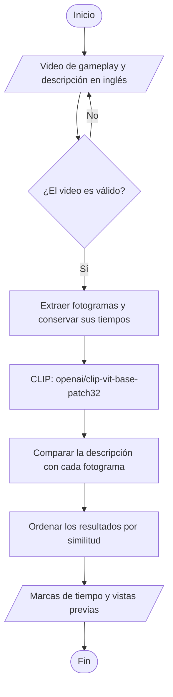
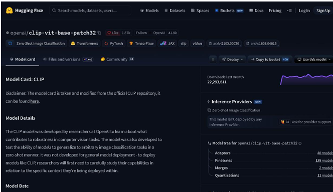
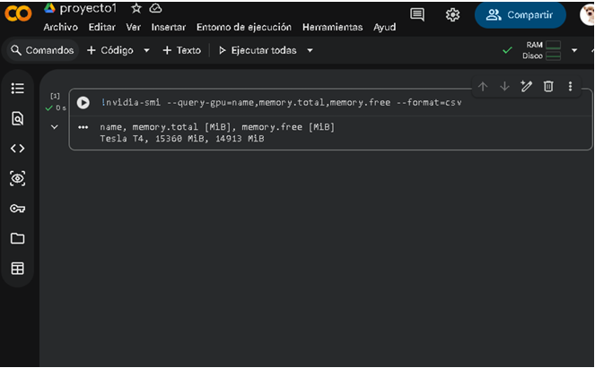

# ClipQuest

> Buscar escenas en grabaciones de videojuegos a partir de una descripción en inglés.

**Proyecto integrador · Herramientas de Procesamiento para IA**

## Equipo

**Grupo:** B · **Equipo:** 1

| Nombre completo |
| --- |
| Diego Isaac Rico Hernández |
| César Iván Macías Anguiano |
| Ernesto Tehuintle Ramírez |
| Sebastián Guerrero Ambriz |

## 1. Caso de uso

Jugadores y creadores de contenido necesitan **localizar escenas** sin revisar toda su partida. La propuesta de ClipQuest es recibir un video de hasta cinco minutos y una descripción breve en inglés para buscar los momentos visualmente más relacionados.

- **Entrada:** un video de gameplay y una descripción de la escena en inglés.
- **Procesamiento:** extraer fotogramas y comparar su contenido con la descripción mediante CLIP.
- **Salida:** marcas de tiempo y vistas previas de las escenas más relacionadas, para facilitar la selección de clips.

## 🔀 Cómo funciona

El modelo compara imagen y texto. La extracción de fotogramas y la presentación de sus tiempos son pasos de la aplicación.

## 2. Modelo abierto elegido

| Dato | Respuesta |
| --- | --- |
| Identificador | `openai/clip-vit-base-patch32` |
| Model Card | [Ficha del modelo en Hugging Face](https://huggingface.co/openai/clip-vit-base-patch32) |
| Tarea (pipeline tag) | `zero-shot-image-classification` |
| Uso en el proyecto | Comparar fotogramas del video con una descripción en inglés |
| Número de parámetros | Aproximadamente 151.28 millones |
| Licencia | MIT, según el [repositorio oficial de CLIP](https://github.com/openai/CLIP/blob/main/LICENSE) |
| Limitación o sesgo declarado | Dificultad para distinguir categorías muy específicas y contar objetos; el rendimiento depende de las categorías utilizadas |

Usaremos descripciones en inglés, el idioma para el que se entrenó y evaluó el modelo según su Model Card.

## 3. Viabilidad de hardware

Estimación de memoria para los pesos del modelo en precisión FP16, con dos bytes por parámetro:

$$
M_{\text{pesos, FP16}} = 151{,}280{,}000 \times 2\ \text{bytes}
= 302{,}560{,}000\ \text{bytes} \approx 0.303\ \text{GB}
$$

Esta cifra corresponde únicamente a los pesos. La ejecución también requiere memoria para los fotogramas, las activaciones y las librerías.

- **GPU observada en la práctica:** Tesla T4 de Colab, con 15,360 MiB de VRAM total según la captura.
- **Dónde se propone ejecutar:** Colab con GPU.
- **Cómo se controlará la memoria:** procesar los fotogramas en lotes pequeños.

## 4. Riesgo ético

- **Riesgo:** las grabaciones pueden mostrar conversaciones, nombres de usuario u otros datos personales.
- **Mitigación:** utilizar videos propios o autorizados, evitar conversaciones privadas, ocultar los datos sensibles y eliminar los archivos temporales al terminar. Las grabaciones no se publicarán en el repositorio.

## 5. Evidencia

Captura de la Model Card de `openai/clip-vit-base-patch32`, consultada durante la práctica:

Captura de la GPU y la memoria reportadas en Colab durante la práctica:

