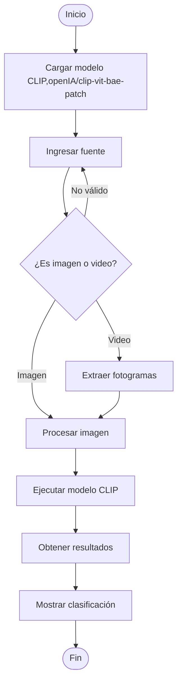

# ClipQuest

> Buscar escenas en grabaciones de videojuegos

**Proyecto integrador · Herramientas de IA**

**Grupo:** B1·
**Equipo:** 1

## 👥 Integrantes

| Nombre completo | 
|-----------------|
| Diego Isaac Rico Hernández|
| César Iván Macías Anguiano |
|Ernesto Tehuintle Ramírez|
|Sebastián Guerrero Ambriz|

## 1. Caso de uso

Jugadores y creadores de contenido necesitan **localizar escenas** sin revisar toda su partida. El
usuario cargará un video de hasta *cinco minutos* y escribirá una descripción breve en inglés. Recibirá
marcas de tiempo y vistas previas de los momentos visualmente más relacionados para facilitar su
edición.

- **Entrada:** video y fotos del gameplay
- **Salida:** clip exacto con relacion a lo buscado

  El diagrama debe mostrar **qué entra**, **qué modelo lo procesa** y **qué sale**, igual que en tu caso de uso.
6. En tu nota `Bitácora`, agrega un enlace a `[[README]]` y marca como hecha la casilla que corresponda.
7. Revisa la lista de verificación.

## 🔀 Cómo funciona

## 2. Modelo abierto elegido

| Dato                         | Respuesta                                                                        |
| ---------------------------- | -------------------------------------------------------------------------------- |
| Identificador                | [openIA/clip-vit-bae-patch](https://huggingface.co/openai/clip-vit-base-patch32) |
| Tarea (pipeline tag)         | `zero-shot-image-classification`                                                 |
| Número de parámetros         | 151.28 millones                                                                  |
| Licencia                     | MIT                                                                              |
| Limitación o sesgo declarado | Dificultades para distinguir categorías muy específicas y contar objetos         |

## 3. Viabilidad de hardware

$$
\text{Memoria mínima} = 151,280,000 \times 2\ \text{bytes} \approx \ 0.303 \ \text{GB}
$$

- **VRAM disponible en Colab:** 15,360 MiB (Tesla T4)
- **Dónde se ejecuta:** Colab con GPU
- **Por qué:** Procesaremos fotogramas en lotes
pequeños para controlar la memoria.

## 4. Riesgo ético

- **Riesgo:** las grabaciones pueden mostrar conversaciones o datos personales. Usaremos videos
propios o autorizados, eliminaremos los archivos temporales al terminar y no publicaremos las
grabaciones en el repositorio.

- **Mitigación:** Utilizar únicamente videos propios o autorizados, evitar grabar información personal o conversaciones privadas, difuminar cualquier dato sensible que aparezca y eliminar los archivos temporales al finalizar el proyecto. Además, no subir las grabaciones al repositorio para proteger la privacidad de las personas.

## 5. Evidencia

